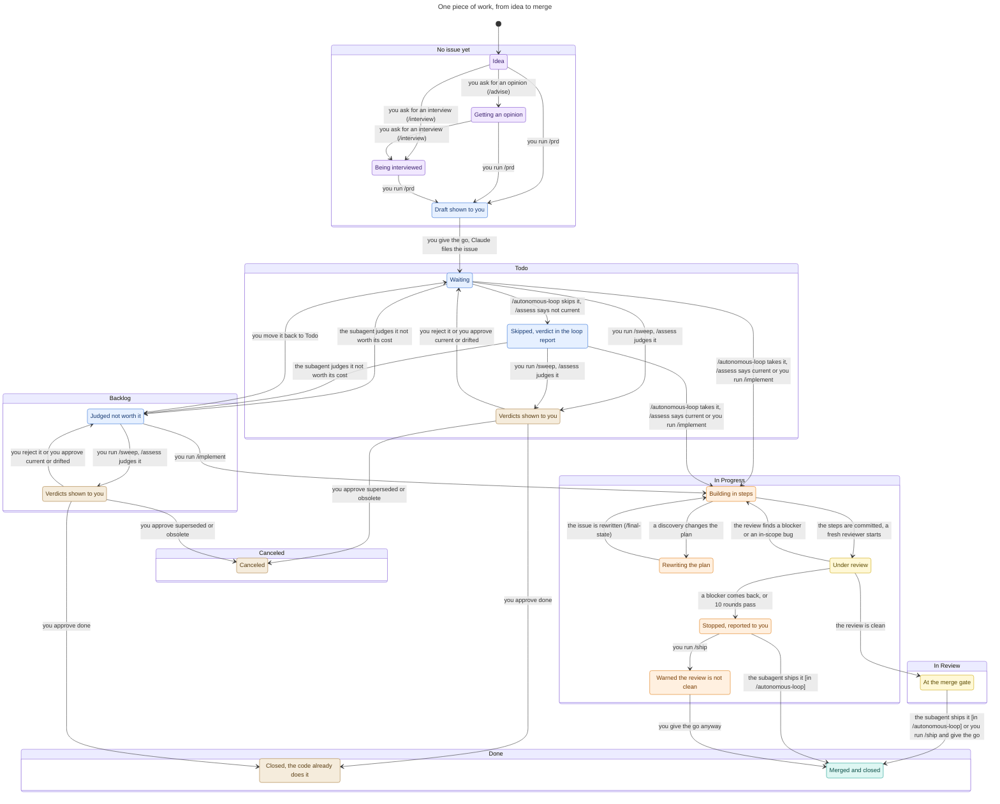

# pipe-skills

A Claude Code plugin that runs a spec-to-ship pipeline on Linear or on GitHub Issues. An issue is the specification. Claude implements it in validated, committed steps, has a fresh reviewer check the work until the review is clean, and stops at the merge gate. When you are ready, Claude squash-merges the work and closes the issue. It can also work through a whole `Todo` queue on its own, one issue after another.

The plugin also has the working-style skills that the pipeline relies on: give an opinion without changing anything, interview you for a spec, keep documents at their final state, and turn corrections into lasting rules.

## Install

```
/plugin marketplace add felipeam86/pipe-skills
/plugin install pipe-skills@pipe-skills
```

## Setup

Run `/pipe-skills:setup` in the project. It asks for Linear or GitHub Issues, checks what the tracker needs, fixes what it can after your go, and writes the line of the project `CLAUDE.md` that names where the work lives. On Linear, that line names one project, or one initiative whose projects are the outcomes of the work. Both trackers use the `gh` CLI when the repository has a GitHub remote.

## Skills

The pipeline:

| Skill | What it does | Example |
|---|---|---|
| `setup` | Makes a project ready: the tracker line in `CLAUDE.md`, and the team with its project or initiative, or the GitHub project, with its states and priority. | `/pipe-skills:setup` |
| `prd` | Files an issue that is the specification of its own implementation in the outcome it serves, or a new outcome, or updates one after the plan changes. | `/pipe-skills:prd file an issue for the CSV export we just discussed` |
| `assess` | Judges whether one `Backlog` or `Todo` issue still matches the code and its goal, and gives a verdict with the evidence. Changes nothing. | `/pipe-skills:assess #42` |
| `implement` | Implements one issue in a worktree, commits each validated step, reviews with fresh reviewers until a round finds no blocker and no in-scope bug, and stops at the merge gate. | `/pipe-skills:implement ACM-42` or `/pipe-skills:implement #42` |
| `review` | Reviews a pull request or a branch, and gives a merge verdict first. | `/pipe-skills:review 118` |
| `ship` | Rebases, squash-merges, closes the issue, files only the follow-ups that earn an issue, and cleans up the branch and the worktree. | `/pipe-skills:ship ACM-42` |
| `sweep` | Runs `assess` on every `Backlog` and `Todo` issue, or on the issues you name, reports the verdicts, and applies only the ones you approve: a review comment, a rewrite, a close, or a cancel. | `/pipe-skills:sweep` or `/pipe-skills:sweep #42` |
| `autonomous-loop` | Implements and ships the issues you name, or every issue of one project in `Todo` state, with no stop for you, from the highest priority, one fresh subagent per issue. It skips an issue that `assess` finds not current, and changes nothing on it. | `/pipe-skills:autonomous-loop` |

Working style:

| Skill | What it does | Example |
|---|---|---|
| `advise` | Gives an opinion or a plan, and changes no file. | `/pipe-skills:advise is this cache layer worth it?` |
| `interview` | Interviews you in depth to write a specification. | `/pipe-skills:interview the onboarding redesign` |
| `final-state` | Edits a document, an issue, or a comment so that it states only the settled decision, removes traces of previous ones, and keeps the rationale. | `/pipe-skills:final-state docs/design.md` |
| `promote-rule` | Turns a correction you just made into a durable rule, at the level it governs. | `/pipe-skills:promote-rule` |

## How the skills fit together

One piece of work moves through the states of its issue in the tracker. Each arrow names who acts, and the skill when one runs. `setup` is not on the chart, because it runs once before the first issue, and `promote-rule` is not on it, because it can run at any time, when you correct Claude. `assess` alone is not on it, because it changes nothing. The model behind the chart, and the rules that TLC checks on it, are in `docs/statecharts`.



Colors: purple = talk, blue = specify, orange = build, yellow = review, teal = ship, tan = sweep.

## Review bar

A reviewer finds more edge cases in each round. The pipeline ends the loop when a review finds no blocker and no in-scope bug, not when it finds nothing, and it stops after 10 rounds or when a blocker comes back after its fix. A re-review checks the earlier findings and reports only new ones. The reviewer classes each finding as a blocker, in scope (same root cause as the issue, or in the code it touches), or out of scope (a different root cause). Claude fixes the blockers and the in-scope findings in the same branch, and keeps the out-of-scope findings for `ship`, which files a follow-up issue only for a reproduced bug or a feature of high value with a new root cause.

## Credits

- `interview` is the [interview prompt](https://x.com/trq212/status/2005315275026260309) by Thariq Shihipar.
- Many of the ideas behind this plugin are hevily inspired by [Matt Pocock](https://github.com/mattpocock/skills) and [Lauren Tan](https://github.com/cursor/plugins/tree/main/pstack).

The plugin is under the MIT License, see `LICENSE`.
