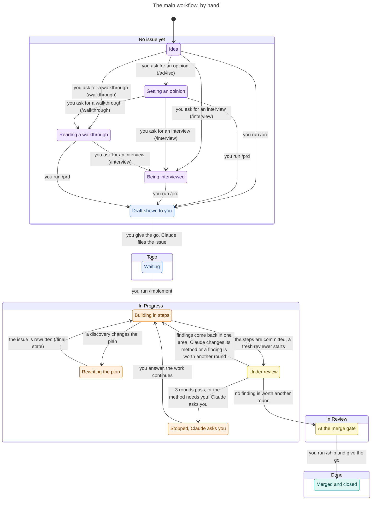
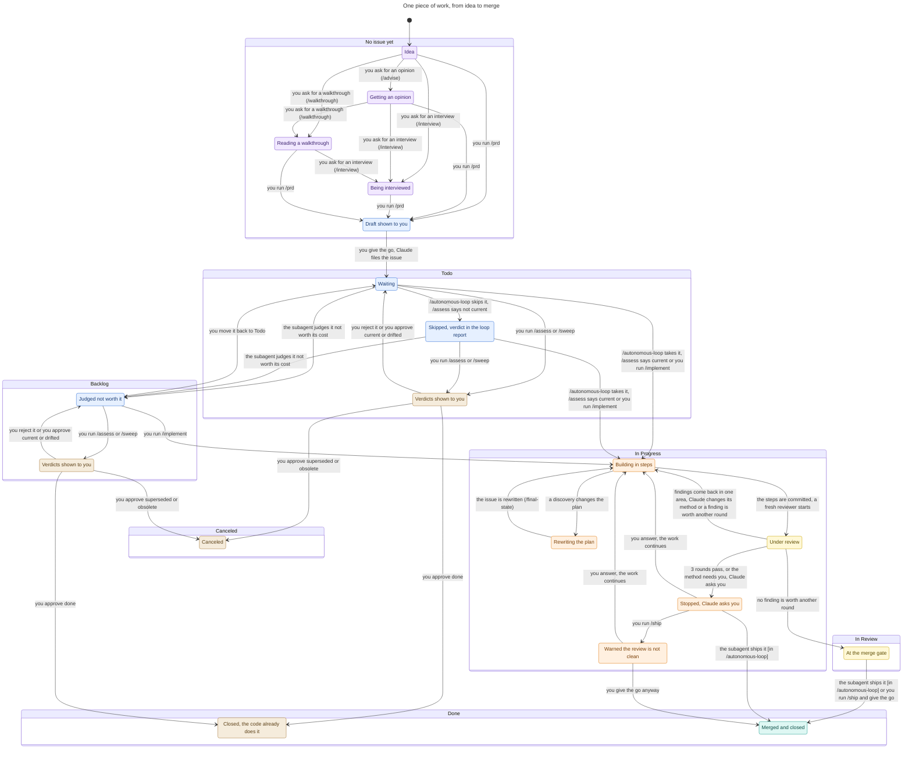

# pipe-skills

A Claude Code plugin that runs a spec-to-ship pipeline on Linear or on GitHub Issues. An issue is the specification. Claude implements it in validated, committed steps, has a fresh reviewer check the work until no finding is worth another round, and stops at the merge gate. When you are ready, Claude squash-merges the work and closes the issue. It can also work through a whole `Todo` queue on its own, one issue after another.

The plugin also has the working-style skills that the pipeline relies on: give an opinion without changing anything, interview you for a spec, keep documents at their final state, turn corrections into lasting rules, and prepare work that Claude does alone while you are away.

## Install

```
/plugin marketplace add felipeam86/pipe-skills
/plugin install pipe-skills@pipe-skills
```

## Setup

Run `/pipe-skills:setup` in the project. It asks for Linear or GitHub Issues, checks what the tracker needs, fixes what it can after your go, and writes the line of the project `CLAUDE.md` that names where the work lives. On Linear, that line names one project, or one initiative whose projects are the outcomes of the work. Both trackers use the `gh` CLI when the repository has a GitHub remote.

## Session names

When you type `implement`, `assess`, `review`, `ship`, or `prd` with an issue, a hook of the plugin names the session `/<skill> <ISSUE-N> - <Issue title>`, for example `/assess GH-12 - Add the away skill to prepare work that Claude does alone while the user is away`. The hook needs `python3`. For a Linear issue, it reads the title with the key in the `LINEAR_API_KEY` environment variable, and without a key the name is `/<skill> <ISSUE-N>`. A skill that Claude starts by itself, such as each issue of `autonomous-loop`, does not rename the session, because Claude Code fires the hook only on a prompt that you type.

## Skills

The pipeline:

| Skill | What it does | Example |
|---|---|---|
| `setup` | Makes a project ready: the tracker line in `CLAUDE.md`, and the team with its project or initiative, or the GitHub project, with its states and priority. | `/pipe-skills:setup` |
| `prd` | Files an issue that is the specification of its own implementation in the outcome it serves, or a new outcome, or updates one after the plan changes. | `/pipe-skills:prd file an issue for the CSV export we just discussed` |
| `assess` | Judges whether one `Backlog` or `Todo` issue still matches the code and its goal, and gives a verdict with the evidence. It changes nothing: after your go, the session applies the verdict and posts the review comment. | `/pipe-skills:assess #42` |
| `implement` | Implements one issue in a worktree, commits each validated step, reviews with fresh reviewers until no finding is worth another round, and stops at the merge gate. | `/pipe-skills:implement ACM-42` or `/pipe-skills:implement #42` |
| `review` | Reviews a pull request or a branch, and gives a merge verdict first. | `/pipe-skills:review 118` |
| `ship` | Rebases, squash-merges, closes the issue, files only the follow-ups that earn an issue, and cleans up the branch and the worktree. | `/pipe-skills:ship ACM-42` |
| `sweep` | Runs `assess` on every `Backlog` and `Todo` issue, or on the issues you name, reports the verdicts, and applies only the ones you approve: a review comment, a rewrite, a close, or a cancel. | `/pipe-skills:sweep` or `/pipe-skills:sweep #42` |
| `autonomous-loop` | Implements and ships the issues you name, or every issue of one project in `Todo` state, with no stop for you, from the highest priority, one fresh subagent per issue. It skips an issue that `assess` finds not current, and changes nothing on it. | `/pipe-skills:autonomous-loop` |

Working style:

| Skill | What it does | Example |
|---|---|---|
| `advise` | Gives an opinion or a plan, and changes no file. | `/pipe-skills:advise is this cache layer worth it?` |
| `walkthrough` | Builds one interactive HTML report that explains a subject or prepares a decision, with hovers, progressive disclosure, and a reply that you paste back into the session. | `/pipe-skills:walkthrough the options for the cache layer` |
| `interview` | Interviews you in depth to write a specification. | `/pipe-skills:interview the onboarding redesign` |
| `final-state` | Edits a document, an issue, or a comment so that it states only the settled decision, removes traces of previous ones, and keeps the rationale. | `/pipe-skills:final-state docs/design.md` |
| `promote-rule` | Turns a correction you just made into a durable rule, at the level it governs. | `/pipe-skills:promote-rule` |
| `away` | Before you leave Claude to work alone for hours, proves each access the work needs, asks all its questions at once, and tells you when you can go. | `/pipe-skills:away migrate the app tonight; I can't answer questions` |

## How the skills fit together

One piece of work moves through the states of its issue in the tracker. Each arrow names who acts, and the skill when one runs. `setup` is not on the charts, because it runs once before the first issue, and `promote-rule` and `away` are not on them, because each can run at any time: `promote-rule` when you correct Claude, and `away` before any work you leave to Claude. The model behind the charts, and the rules that TLC checks on it, are in `docs/statecharts`.

Colors: purple = talk, blue = specify, orange = build, yellow = review, teal = ship, tan = sweep.

### The main workflow

The path that you drive by hand, with the main skills: from an idea to an issue, then to a merge.



### The full lifecycle

Everything else that can happen to an issue: `autonomous-loop` runs the work without you, `assess` and `sweep` check a waiting issue against the code, and `ship` warns you when the review is not clean.



## Review bar

A reviewer can always find one more edge case, so the bar comes from the issue: its Business impact gives the weight of the work, and a small issue gets a small change and a short review. A fresh reviewer reads only the issue, the change, and the rules of the project, and raises only a finding the user would act on, never one that is unlikely or that fails safe. The loop ends when no blocker is left and no remaining finding is worth another round. When findings come back in one area, Claude questions its method instead of adding a guard, and after 3 rounds it stops and asks you. The reviewer classes each finding as a blocker, in scope (same root cause as the issue, or in the code it touches), or out of scope (a different root cause). Claude fixes the blockers and the in-scope findings worth their cost in the same branch, and keeps the out-of-scope findings for `ship`, which files a follow-up issue only for a reproduced bug or a feature of high value with a new root cause.

## Credits

- `interview` is the [interview prompt](https://x.com/trq212/status/2005315275026260309) by Thariq Shihipar.
- Many of the ideas behind this plugin are hevily inspired by [Matt Pocock](https://github.com/mattpocock/skills) and [Lauren Tan](https://github.com/cursor/plugins/tree/main/pstack).

The plugin is under the MIT License, see `LICENSE`.
